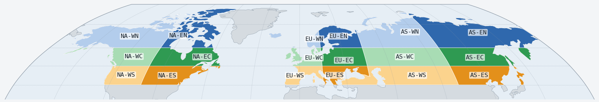

# Heatwave Box Atlas

Interactive atlas of blocking-driven summer heatwaves in 18 Northern Hemisphere regions
(North America, Europe and Asia, each split into west/east and three latitude bands).
MPI-ESM1.2-LR (MPI Grand Ensemble), 5 members, historical (1850–2014) + SSP3-7.0 (2015–2100), June–August.

Click a region to see:

- heatwave days per decade, with historical and SSP3-7.0 trends
- the share of heatwave days in each surface-flux regime (energy-limited, transitional, moisture-limited, atmosphere-to-surface heating)
- heatwave surface temperature by regime
- local wave activity (LWA) of the heatwaves, and the distribution of daily summer LWA in the region

The page is static (`index.html` + `figs/`), so it runs on GitHub Pages as is.
